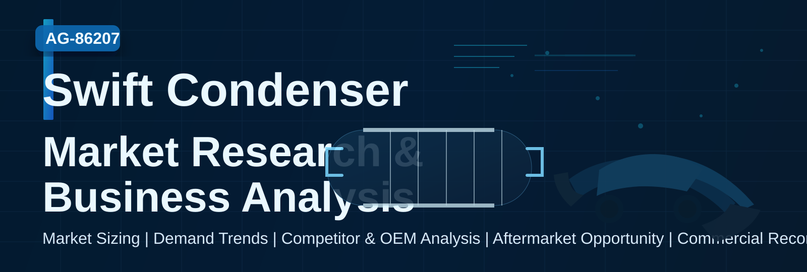

# Swift_Condenser_Legacy_Analysis

Mapping Maruti Suzuki sales to market contribution for a client.

## Repository structure

- [research/README.md](research/README.md) — research folder overview
- [research/01-first-draft.md](research/01-first-draft.md) — structured first-draft research document
- [deliverables/README.md](deliverables/README.md) — final deliverables overview
- [deliverables/client-ready-report.md](deliverables/client-ready-report.md) — client-facing report draft
- [deliverables/commitments.md](deliverables/commitments.md) — project commitments and scope

## Status

This repository now includes the initial research draft and a client-ready report structure, along with project commitments captured in the repository.
